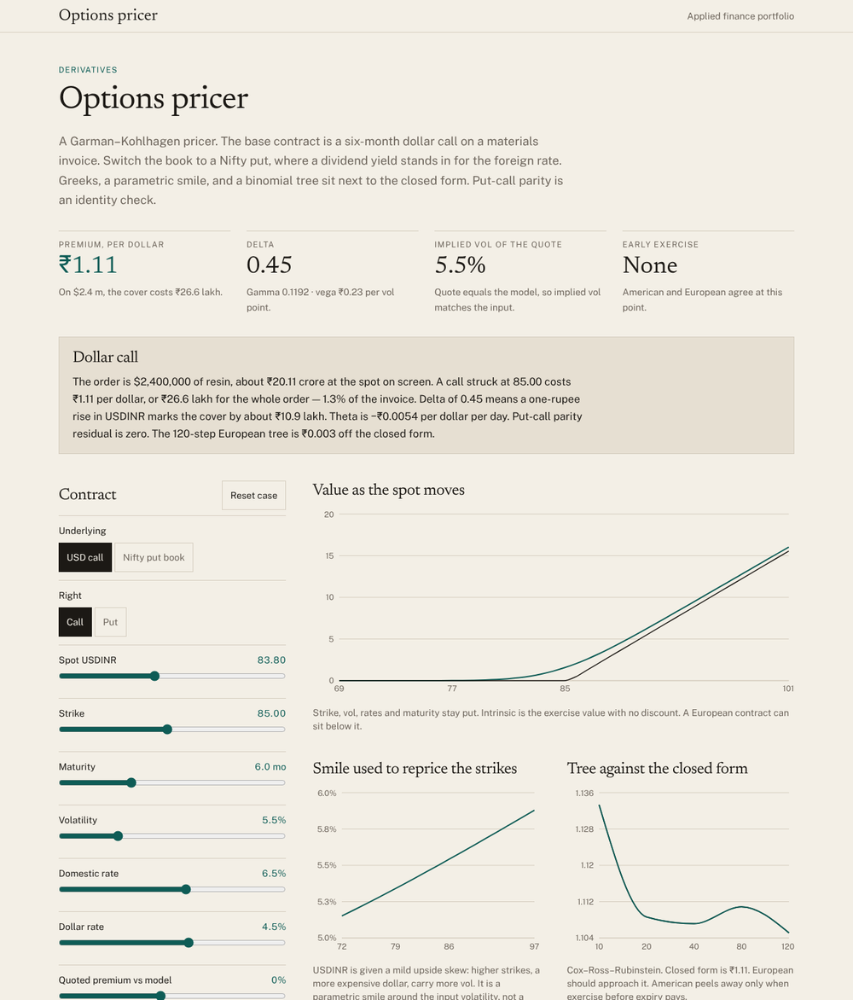

# Options pricer

A Garman–Kohlhagen pricer for a six-month USDINR call on an imported materials invoice, switchable to a Nifty put, with Greeks, implied volatility, a parametric smile and a Cox–Ross–Rubinstein tree beside the closed form. Everything is computed live in the browser.



**Live:** https://tanmayvasvani.github.io/options-pricer/ · **Author:** Tanmay Vaswani

## What it does

The base contract covers a $2.4 million resin order: a six-month call on USDINR struck at 85 with spot at 83.80, 5.5% volatility, a 6.5% rupee rate and a 4.5% dollar rate. The page prices it per dollar and for the whole order, and reads the result back in commercial terms (what share of the invoice the cover costs, what a one-rupee move does to it, what a day of decay costs). The second book is a three-month Nifty put, where a dividend yield stands in for the foreign rate.

- **Closed form** price with delta, gamma, vega, theta and both rhos (domestic and foreign, because a currency option has two rates).
- **Implied volatility** of a quoted premium, solved by Newton's method on vega. If the quote sits below the no-arbitrage floor, no volatility reproduces it.
- **Put–call parity** as a live identity check.
- **Value as the spot moves**, against intrinsic value.
- **A parametric smile** (mild upside skew for USDINR, the usual equity skew for the index) used to reprice a ladder of strikes.
- **A binomial tree** at 10 to 120 steps, European and American, converging on the closed form, with early-exercise value reported when it exists.

Base case: ₹1.11 per dollar, ₹26.6 lakh on the order (1.3% of the invoice), delta 0.45.

## Method

- d₁ = [ln(S/K) + (r_d − r_f + σ²/2)T] / (σ√T), d₂ = d₁ − σ√T. Call = S·e^(−r_f T)·N(d₁) − K·e^(−r_d T)·N(d₂); the put follows by symmetry. Black–Scholes–Merton with a continuous dividend yield is the same function with the yield passed as r_f.
- The normal CDF is Hart's rational approximation as given by West (2005), accurate to roughly 1e-14, so finite-difference Greeks agree with the analytic ones to many digits (the tests check this).
- The tree is Cox–Ross–Rubinstein with u = e^(σ√Δt), d = 1/u and the risk-neutral probability built from the same two rates. American value is the maximum of continuation and immediate exercise at every node.
- The smile is ATM vol × (1 + skew·m + convexity·m²) in log-moneyness m relative to the forward. It is illustrative, not fitted to a market.

## Checks

`npm test` runs 33 assertions, including: the textbook Black–Scholes case (S = K = 100, T = 1, σ = 20%, r = 5%) prices to 10.4506 / 5.5735; put–call parity holds on every book; call and put deltas differ by exactly e^(−r_f T); delta, gamma, vega, theta and both rhos match central finite differences to 5–7 digits; implied vol round-trips the model price and returns null below the arbitrage floor; the tree converges to the closed form, never exercises a call early when the underlying pays nothing, and finds early-exercise value on a deep in-the-money put; and the normal CDF matches double-precision reference values to 12 digits.

## Run it locally

```bash
npm install
npm run dev        # http://localhost:5173
npm test           # vitest
npm run build      # typecheck + static build into dist/
```

Requires Node 20 or newer.

## Deploy

The build is a static site (`dist/`) with relative asset paths, so it works on Vercel, Netlify, Cloudflare Pages or GitHub Pages with no configuration beyond "build command `npm run build`, output directory `dist`".

## Stack

React 19, TypeScript (strict, `noUncheckedIndexedAccess`), Vite, Tailwind CSS 4, Recharts, Vitest. The pricing library is `src/lib/options.ts` and the normal CDF is in `src/lib/stats.ts`; neither has dependencies.

## Data

Spot, rates and volatilities are inputs, not live market data.

## License

MIT
